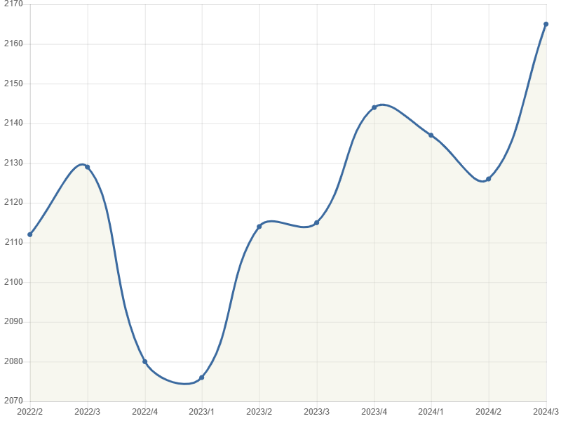

<div style="text-align: left; font-size: smaller;">
Photo by Egbert Schroeer -  <i>Cowiche Canyon - May 2024</i>
</div>
<br>
<br>
Hello chess enthusiasts,

I thought it was time for another blog post to share some games and learnings with you, and to update you on my progress. Officially, I have set my goal as the "Road to 2200," which will be challenging given that I am now paired against stronger players than in the past.



That said, as of the last official calculation, I reached an ELO of 2165 for the period 2024/3-7/1/2024.

# Champions League

Here are the recent games I finished in the Champions League:

1. CL/2024/C2 Albano Rivares, Fernando - loss
2. CL/2024/C2 Underwood, Wesley K. - draw
3. CL/2024/C2 Pierron, Pascal - draw

Despite a system slip that resulted in an unfortunate resignation after move 2, the tournament is going better than expected. However, I have not secured a win so far. Let's start with a detailed look at the games.

## Game Analysis: Fernando Albano Rivares

After the system slip, I was distracted and not focused on my game with Fernando Albano Rivares, a true gentleman and wonderful person to play and chat with. I played a line I have played a gazillion times, but due to distraction, I blundered on my 10th move. Instead of castling, I took exd4. Oh boy, I immediately knew that was it. Additionally, I made two more inaccurate moves and could not survive against two strong bishops.

```pgn
[Event "Champions League 2024 C2"]
[Site "ICCF"]
[Date "????.??.??"]
[Round "?"]
[White "Schroeer, Egbert"]
[Black "Albano Rivares, Fernando"]
[Result "0-1"]
[ECO "A13"]
[WhiteElo "2137"]
[BlackElo "2121"]
[Annotator "Schroeer,Egbert"]
[PlyCount "76"]
[GameId "492428435275"]
[EventDate "2024.02.25"]
[EventType "corr"]

1. Nf3 Nf6 2. c4 e6 (2... c5 {[%cal Gc7c5]} 3. e3 {[%cal Ge2e3]} (3. Nc3 d5 4.
cxd5 Nxd5 5. e3 {[%cal Gd1c2]} Nxc3 (5... e6 6. Qc2 {[%cal Ga2a3,Gb2b3,Gc1b2]})
6. bxc3 g6 7. h4 Bg7 8. h5 Nc6 9. Ba3 {[%csl Ga3]} Qa5 10. Rh4 {[%cal Gh4a4]})
3... d5 4. cxd5) 3. b3 (3. g3 a6 4. Bg2 b5 5. b3 Bb7 6. Nc3 b4 7. Na4 Be7 8.
Bb2) 3... d5 4. Bb2 c5 5. e3 Nc6 6. cxd5 {[%cal Gf6d5]} (6. Be2 d4) 6... exd5
{[%cal Gf1b5,Gf1e2]} 7. Be2 (7. d4 cxd4 8. Nxd4 Ne4 {[%cal Gf8b4,Gb4e1]} (8...
Be7 9. Be2 O-O 10. O-O a6 11. Nc3)) (7. Nc3 $5 d4 (7... Be7 {[%cal Gf1b5]} 8.
Rc1 O-O (8... d4 {[%cal Gd5d4]} 9. Na4 Qa5 10. a3 {[%cal Ga4c5,Gb3b4]}) 9. d4
{[%csl Gc1,Gc3][%cal Ga5e1]} cxd4 10. Nxd4 {[%csl Gg4][%cal Gf1e2,Ge2g4,Ge1g1]})
8. Na4 {[%cal Ga1c1,Ga4c5,Gf1b5]} d3 9. Bxf6 {[%csl Gd3][%cal Gd8f6]} gxf6 10.
Rc1 {[%cal Gc6b4,Gb4c2,Gc1c2]}) 7... d4 (7... Bd6 {[%cal Ge1g1,Gd2d4,Gb1c3]} 8.
d4 (8. Nc3) (8. O-O)) 8. Bb5 {try to create a double ? for Black} (8. exd4 cxd4
{...d3 is the strong threat.} 9. Bb5 {[%cal Ye1g1]} Bc5 10. Qe2+) 8... Bd6 (8...
Bd7 9. O-O {With the idea Bxc6.} Be7 10. exd4 Nxd4 11. Nxd4 cxd4) 9. Bxc6+ bxc6
{The position is equal.} 10. exd4 $2 {mouse slip; bad karma? I was distracted,
for sure. What a blunder!} (10. O-O O-O 11. exd4 Ba6 (11... cxd4 12. Bxd4 (12.
Nxd4 {[%cal Yf1e1] don't fall for this trap} Ng4 13. Nxc6 $2 (13. Nf3 $17) 13...
Bxh2+ $19) 12... Bb8 (12... Bg4 13. Nc3 Bxh2+ 14. Kxh2 Bxf3 15. Qxf3 Qxd4 16. g3
$15)) 12. Re1 cxd4 13. Bxd4 Nd5 14. Nc3) (10. O-O $10 {and White is okay.})
10... Ba6 $19 11. d3 Qe7+ 12. Qe2 Qxe2+ (12... Bxd3 13. Qxe7+ Kxe7 14. dxc5 Bxc5
15. Ne5 $10) 13. Kxe2 O-O-O $17 (13... O-O) 14. Re1 {[%cal Bh1e1,Be1e7,Be7f7]}
(14. Rd1 Nd5 $1 15. dxc5 (15. Ne1 Rhe8+ 16. Kf1 Nb4 {[%cal Ye8e1] ...Rxe1+!
would now be deadly.} 17. g3 Rxe1+ 18. Kxe1 cxd4 {And now ...c5 would win.} 19.
a3 Nxd3+ 20. Rxd3 Bxd3 21. Bxd4 Bxg3 22. hxg3 Rxd4 23. b4) (15. g3 Nb4 {Strongly
threatening ...Rhe8+.} 16. Ne1 Rhe8+ 17. Kf1 Rxe1+ 18. Kxe1 cxd4 {Threatens to
win with ...c5.} 19. a3 Nxd3+ 20. Rxd3 Bxd3 21. Bxd4 Bxg3 22. hxg3 Rxd4 23. b4
c5 24. bxc5 Kc7 25. Nc3 Kc6 26. f3 Kxc5) 15... Bxc5 {White must now prevent
...Nf4+.} 16. Kf1 {[%cal Yb1c3]} Nf4 17. Ne1 {[%cal Yb1c3]} Rhe8 18. Nc2 $2 (18.
Nc3 $17) 18... Rxd3 $19 19. Rxd3 Nxd3) (14. Nc3 Rhe8+ 15. Kf1 (15. Kd2 $2 cxd4
16. Ne4 Nxe4+ 17. dxe4 Rxe4 $19) 15... cxd4 (15... Bxd3+ $2 16. Kg1)) 14... Nd5
{[%cal Bf6d5,Bd5f4,Bf4d3,Bd3f2]} (14... Rhe8+ 15. Kf1 $17) 15. Kd1 Nf4 (15...
Bxd3 16. Nc3 Nb4 17. Ne4 $17) 16. dxc5 Bxc5 17. d4 (17. Bxg7 Rhg8 (17... Rxd3+
18. Nbd2 $17) 18. Bf6 Rxd3+ 19. Nbd2 Bxf2 $19 (19... Nxg2 20. Re5 $17) (19...
Rxg2 $2 20. Re8+ Kd7 21. Rd8+ Kc7 22. Rxd3 $19)) 17... Bb6 {[%cal Yf4d3]} (17...
Nxg2 18. Re4 $17 (18. Rg1 Nf4 $17)) 18. Re7 Rhe8 (18... Nxg2 19. Nbd2 $17) 19.
Rxf7 Nd3 (19... Nxg2 20. Nbd2 $17) 20. Bc3 Nxf2+ 21. Kc1 {[%cal Yb1d2]} c5
{[%cal Rc5d4]} 22. Bd2 cxd4 23. Rxg7 Kb8 24. Na3 Re2 25. Rb1 Ka8 26. Rxh7 Ne4
27. Rb2 d3 {[%cal Ye2f2]} (27... Rxg2 $2 28. Be1 Be2 29. Rg7 Rc8+ (29... Rxg7 $2
30. Rxe2 Nd6 31. Rd2 $19) 30. Nc4 Rxg7 31. Rxe2 $19) 28. Rh4 Bc5 29. Nb1 (29.
Nc4 Bxc4 30. bxc4 Ba3 $19) 29... Bb7 {[%cal Yd8c8]} 30. Ne5 (30. Nc3 Nxc3 31.
Bxc3 Ba3) 30... Bd4 {( -> ...Rc8+). A strong pair of Bishops.} 31. Nxd3 Bxb2+
32. Kxb2 Nxd2 33. Nf4 Rf2 34. Nxd2 Rdxd2+ {Black is clearly winning.} 35. Kc3 a5
36. a4 Rc2+ ({Less strong is} 36... Bxg2 37. Nxg2 Rc2+ (37... Rxg2 $2 38. Rh5
$19) 38. Kd3 Rfd2+ (38... Rxg2 $2 39. Rh5 $19) 39. Ke4 Rxg2 40. Rh5 $19) 37. Kd4
Rfd2+ ({Don't take} 37... Bxg2 38. Nxg2 Rxg2 39. Rh5 $19) 38. Ke3 Rd8 {Black
took control after the opening. Weighted Error Value: White=0.23 (precise)
/Black=0.01 (flawless) . Loses game: White=1 --- Inaccurate: White=1 --- OK:
White=12 Black=24 Best: White=4 Black=2} ({Don't do} 38... Bxg2 39. Rh5 $19) 0-1
```

<br>

This game clearly shows that in chess, you need to stay focused. A momentary lapse in concentration can lead to a critical mistake, as seen in my 10th move. Always keep your head in the game!

## Game Analysis: Wesley K. Underwood

An interesting game where I followed my strategy to use uncommon lines and create a complicated position with move 6, and got out of theory by move 9. However, Black played very smartly, and after move 22, I agreed to a draw because I didn't find any breakthrough. But check it out, I might be wrong. Let me know your feedback or leave a comment.

```pgn
[Event "Champions League 2024 C2"]
[Site "ICCF"]
[Date "????.??.??"]
[Round "?"]
[White "Schroeer, Egbert"]
[Black "Underwood, Wesley K."]
[Result "1/2-1/2"]
[ECO "A22"]
[WhiteElo "2137"]
[BlackElo "1918"]
[Annotator "Schroeer,Egbert"]
[PlyCount "44"]
[GameId "492804364495"]
[EventDate "2024.02.25"]
[EventType "corr"]

1. c4 e5 2. Nc3 Nf6 3. Nf3 Nc6 4. e3 {1-0 Caruana,F (2822)-Karjakin,S (2782)
Norway Chess 6th Stavanger 2018 (5.2) searching for an edge in a different
direction. Or in other words: transpose to my main lines} Bb4 5. Qc2 Bxc3 6.
bxc3 {[%cal Rd7d6,Ge3e4,Gd2d4,Gd2d5,Gf1e2] I believe bxc3 creates the better
position} (6. Qxc3 Qe7 7. b3) 6... d6 7. d4 O-O 8. Be2 Re8 $5 {Black is slightly
better.} (8... Bg4 9. h3 Bh5 10. O-O) 9. d5 {out of theory in the 9th move, fine
for me} (9. Nd2 Bg4 {Threatens to win with ...Bxe2.} 10. f3) 9... Na5 10. e4 b6
11. Nd2 Ba6 12. O-O c6 {next ...cxd5 is good for Black.} 13. Qd1 (13. Re1 Rc8
14. Bf1) 13... Rc8 14. Ba3 {this was a sideline I calculated but became the main
line} cxd5 15. cxd5 Bxe2 (15... Rxc3 $2 {too greedy.} 16. Bxa6 Rxa3 17. Nb1 $18)
16. Qxe2 Rxc3 17. Bb4 Rc7 18. Rfc1 Qd7 19. Rxc7 Qxc7 20. Qa6 g6 21. f3 Nd7 22.
Nb3 Qc4 {Weighted Error Value: White=0.05 (flawless) /Black=0.05 (flawless) .
Inaccurate: White=1 --- OK: White=10 Black=8 exchanging ? and ends in equal
position. Black might be slightly better} 1/2-1/2
```

<br>

## Game Analysis: Pascal Pierron

An interesting game where Pascal played very well. With move 19, I realized I had played the same position recently. Due to preparation in such a tournament, I thought it was a good idea to change gears and take a different route. However, I was behind and thought I could lose the game. I managed with 6 best moves and Pascal with 2 inaccuracies to catch up and reach a draw position.

```pgn
[Event "Champions League 2024 C2"]
[Site "ICCF"]
[Date "????.??.??"]
[Round "?"]
[White "Pierron, Pascal"]
[Black "Schroeer, Egbert"]
[Result "1/2-1/2"]
[ECO "B08"]
[WhiteElo "2166"]
[BlackElo "2137"]
[Annotator "Schroeer,Egbert"]
[PlyCount "64"]
[GameId "492890956482"]
[EventDate "2024.02.25"]
[EventType "corr"]

1. e4 d6 2. d4 Nf6 3. Nc3 g6 4. Nf3 Bg7 5. Be3 a6 6. Qd2 b5 7. Bh6 O-O 8. Bd3
Nc6 {White is slightly better.} 9. Bxg7 Kxg7 10. e5 dxe5 11. dxe5 Ng4 12. O-O-O
{½-½ Willmann,B (2358)-Enev,Z (2380) ST-00186 corr LSS 2021 Black must now
prevent Qe1.} b4 13. Rhe1 $1 {[%cal Yh2h3]} Rb8 14. Na4 {h3 is the strong
threat.} Qd5 {[%csl Ra2,Re5]} 15. b3 (15. c4 bxc3 16. Nxc3 Qc5 $17) 15... Ngxe5
(15... Ncxe5 16. Nxe5 Nxe5 17. Bf1 (17. Bxa6 Qxg2 18. Rxe5 Qxh2 19. Qd4 Bxa6)
17... Qxd2+ 18. Rxd2) ({But not} 15... Ncxe5 16. Nxe5 Nxe5 17. Bf1 Qxd2+ 18.
Rxd2 $10) 16. Nxe5 Nxe5 17. Bf1 (17. Bxa6 Qxg2 18. Rxe5 Qxh2) 17... Qxd2+ 18.
Rxd2 {½-½ Despontin,L (2382)-Truyens,A (2291) BEL/C79 (BEL) corr ICCF 2023} Nc6
19. Rd5 {[%cal Bd2d5,Bd5c5,Bc5c6]} e5 (19... Nd8 {½-½ Szabo,R (2385)-Schroeer,E
(2114) Veterans World Cup13 sf09 corr ICCF 2023 I played this position before
and captured a draw as Black}) 20. Rc5 Bb7 21. Bxa6 {Deflection. White is more
active.} Bxa6 22. Rxc6 Bb7 23. Rxc7 {aiming for Nc5.} Bxg2 24. Rxe5 {And now Nc5
would win.} Rfe8 25. Rxe8 Rxe8 $14 {Endgame. KRB-KRN. The position is equal.}
26. Rc4 {[%cal Ya4c5] Nc5! would now be deadly.} Re2 27. Rxb4 Rxf2 28. Rd4 Bf3
29. Rd2 Rf1+ 30. Kb2 {Threatens to win with b4.} h5 31. Nb6 {Strongly
threatening a4.} g5 32. a4 {Hoping for Nd5.} Re1 {Weighted Error Value:
White=0.05 (flawless) /Black=0.00 (flawless) . Inaccurate: White=2 --- OK:
White=13 Black=14 Best: White=4 Black=6} 1/2-1/2
```

<br>
I still have four games to go, and I hope to secure at least one win. Our team, FSB Thuringia I, is currently ranked 7th out of 15.

<br>
<br>

**Amici Sumus**

See you next week. If you enjoy my insights, consider supporting me with a virtual coffee! ☕️ Or a beer? Either way 😎 - Your support keeps me fueled to continue sharing valuable content.

Click the coffee mug below at the end of the webpage, please subscribe and share broad and wide.

> [Please subscribe](https://follow.it/senior-chess-improver?leanpub)
