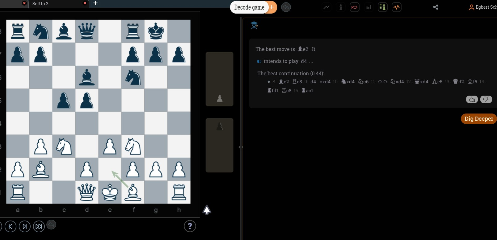
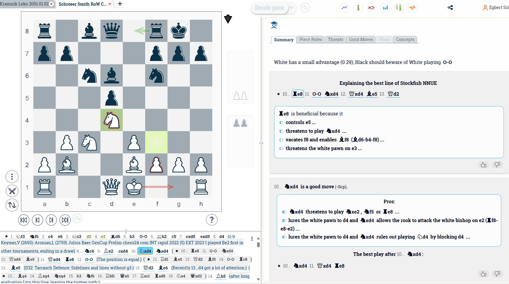
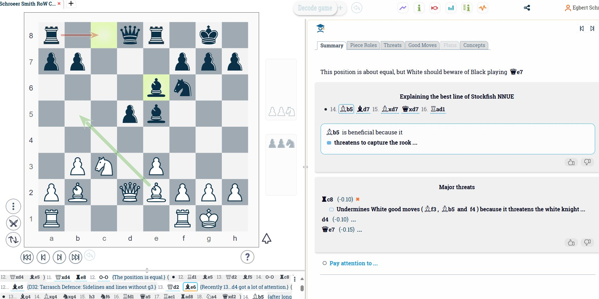
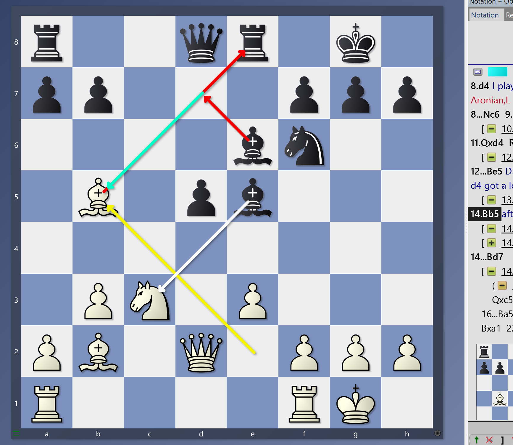
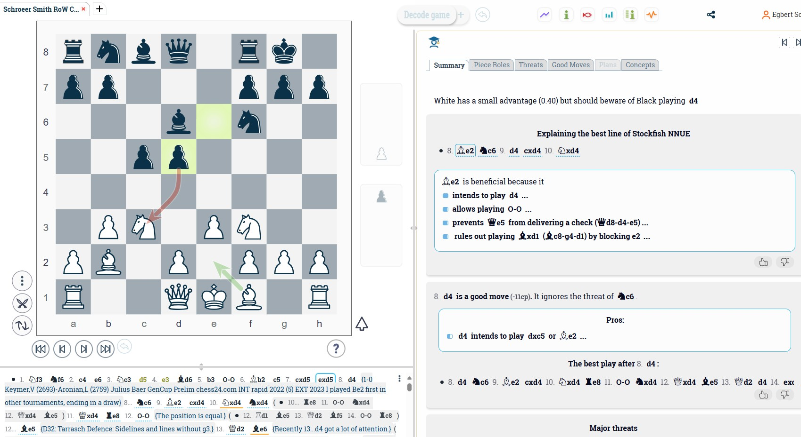
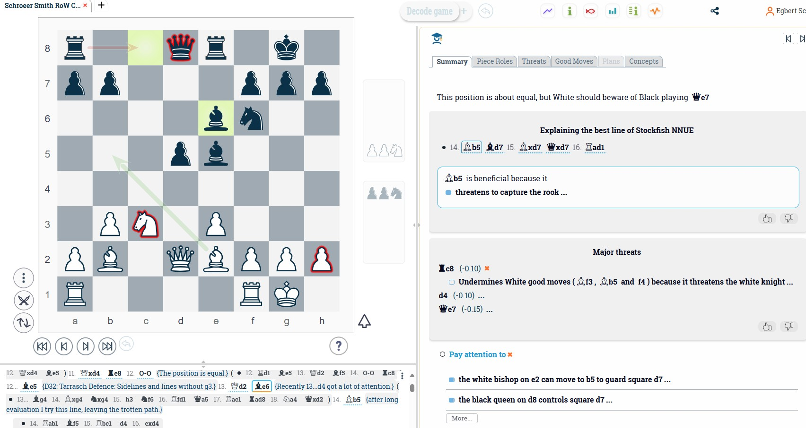
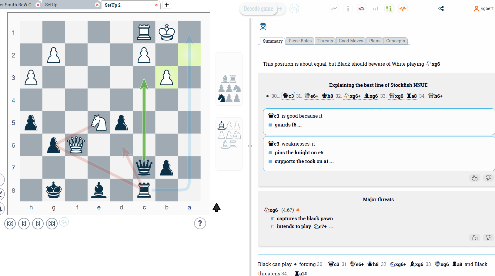

Photo by <a href="https://unsplash.com/@hnhmarketing?utm_content=creditCopyText&utm_medium=referral&utm_source=unsplash">Hunter Haley</a> on <a href="https://unsplash.com/photos/four-handheld-tools-on-board-s8OO2-t-HmQ?utm_content=creditCopyText&utm_medium=referral&utm_source=unsplash">Unsplash</a>

## Introduction  

In todays chess world I still prefer books to sit down, read, learn, explore and adopt strategies or update my repertoire. But Software tools have revolutionized the way we approach chess improvement nowadays and a mix of traditional tools & weapons is probably the right tnhing to do. 
If you haven't read my blog [**Memories - Learning from the Past** ](https://chess.myvortexcloud.com/memories-learning-from-the-past) I encourage you to have a peak too.

Now, what to expect in this blog? Well, it's, part 3 of my **Tools and Weapons** series, and we’ll explore **DecodeChess**, a tool that claims to act as your virtual chess coach. It makes engine analysis more human-friendly and actionable.  

In January 2023, Chessify announced a partnership with DecodeChess, but a year later, users were informed that the partnership ended in January 2024. This came as a surprise to me, as I believe it would have been a great fit.

DecodeChess is developed by Decodea, a company co-founded by Zeev Fine and Ofer Shamai. Decodea creates algorithms that mimic high-level human cognitive functions, which aligns perfectly with the advancement of AI in chess.

---

## DecodeChess: Your AI-Powered Chess Coach?  

Like Noctie.ai, DecodeChess claims to be an AI-powered chess coach that can help you improve your game.  

What stands out about **DecodeChess** is its ability to bridge the gap between raw engine evaluations and practical learning. It offers more detailed, human-like explanations of moves and positions. This approach is similar to the direction ChessBase is taking with ChessBase 18, which now uses ChatGPT’s language model to annotate and comment on games.

Promotional video on YouTube
<iframe width="560" height="315" src="https://www.youtube.com/embed/Wz88WnOBSF8?si=eeinuVd388ETakBD" title="YouTube video player" frameborder="0" allow="accelerometer; autoplay; clipboard-write; encrypted-media; gyroscope; picture-in-picture; web-share" referrerpolicy="strict-origin-when-cross-origin" allowfullscreen></iframe>
---

## Key Features and Promises  

### 1. **Move Explanations**  
DecodeChess explains the best moves in plain language, covering tactics, strategies, threats, and plans. It helps you understand not just *what* to play, but *why* you should play it.  

### 2. **Strength and Weakness Analysis**  
DecodeChess identifies key aspects of your position, such as:  
- Tactical opportunities.  
- Positional weaknesses.  
- Threats from your opponent.  

For example:  
- "Your bishop is dominating the long diagonal, controlling critical squares."  
- "Your exposed king creates tactical vulnerabilities in the endgame."  

### 3. **Personalized Improvement Suggestions**  
Beyond analysis, DecodeChess suggests actionable steps to improve your gameplay in similar positions.  

Now, let's check their updated promotional video, which showcases key improvements to DecodeChess:  

- **Automated Analysis** *(0:33–0:49)*  
  The system now automatically selects 7–10 key moments in your game based on the color of pieces you played with.  

- **Focused Insights** *(1:00–1:57)*  
  DecodeChess explains the moves you played and compares them to the best engine-recommended moves, highlighting critical moments in the game.  

- **Customizable Insights** *(2:28–2:49)*  
  Adjust the number of insights per game in your preferences—choose between 7, 15, or all moves for analysis.  

- **Improved Import Functionality** *(2:53–3:24)*  
  You can now decode games imported from external sources, such as Lichess.  

<iframe width="560" height="315" src="https://www.youtube.com/embed/WPKLYsqDBlA?si=9tcotTV6hFUvGFIl" title="YouTube video player" frameborder="0" allow="accelerometer; autoplay; clipboard-write; encrypted-media; gyroscope; picture-in-picture; web-share" referrerpolicy="strict-origin-when-cross-origin" allowfullscreen></iframe>
 

**Critique:**  
It's funny that in this promotional video, the AI is just blatantly wrong. Check out **time 1:48**: on a blunder, the AI says, _"allows the queen on c7 to guard g3..."_  

- First of all, **the queen isn't on c7**, and guarding g3 is not important in the position at all.  
- Additionally, DecodeChess doesn't even mention the critical fact that **the knight can be taken by the bishop**.  

Okay, nuances and details might require enabling the "Dig Deeper" option, but... phew.  

---

## How It Works  

Ok, jokes and early crique aside, let's take a look at how it works. I analyzed my game with Allyne Smith from the RoW semi-finals by pasting it into DecodeChess.

  
The critical position was move 8, **d4**, where I had previously played **Be2**. Interestingly, that was exactly the move DecodeChess recommended, followed by **d4**. As you can see, the "Go Deeper" function provides further options and explanations.
 

The next critical position is after move 10, **Nxd4**, and potential responses for Black. While **Re8** is a good option, **10... Nxd4** seems to be the engine's favorite, and it provides explanations for why this is the best move. The tool not only gives an accurate recommendation but also explains the pros of the move.

 

Next, we see the position after both knights have been removed, and the queen is retaken and chased away by Black’s bishop.

This is a "Go Deeper" analysis. In this position, I took some time to decide on **Bb5**, a move off the beaten path. It threatens the rook, but I would have expected more detailed insights since this move is part of a broader strategy aimed at creating imbalance, breaking through, and gaining positional advantage.

Here are the threads visualized (with ChessBase):

 

I then revisited the earlier critical position after **7... exd5** to use the "Go Deeper" function fpr move 8. The evaluation was very accurate—keep in mind, I know this opening very well. **Be2** is a solid first move because it allows for castling if necessary, supports a strong line with the queen, and results in a slight advantage (+0.4).

 

Finally I was going back to the position after Black’s bishop chased the queen back. I used the "Pay Attention" function get an idea how DecodeChess see threats and risks. As you can see, DecodeChess also highlights the threats, helping you visualize potential dangers more clearly.

 

What I see are sometimes really weird AI evaluations like this one out of a real game position in the RoW semi-finals I'm actually playing.
I can't approve the message **White has an advantage (1.27) but cannot convert it to a win** -and this is not because I'm playingBlack- but love to have your opinion. Black is a pawn up, but has three pawn islands. DecodeChess judgement is, White has an advantage (1.27) but cannot convert it to a win.
Really? I mean the slightly better position is equalized with one pawn up. But maybe it's just me.

And then it gets interesting. e5 is -even it looks weird- a good move and the assesment is perfect. The position is equal if White takes the pawn and Black plays Qc3. If White plays the better move Qg5 trying to close in, a4 is coming. It's a complicated position and DecodeChess is now doing well explaining the "Why".

And lastly, yes it's an equal position. Well done, DecodeChess!

Now, the final position I like to share is also a real one from my RoW semi-final tournament to showcase the **Plan** function. This was pretty solid!

---

## Pricing  

DecodeChess offers both free and pro plans:  
- **Free Plan:** Limited analysis per month.  
- **Pro Plan:** Unlimited features, advanced insights, and more interactive tools.  
- **Coin-based Plan:** 60 coins for $15, allowing for 60 evaluations or deep-dive analyses.  

---

## My Experience with DecodeChess  

As a correspondence chess enthusiast currently ranked [**#71 in the US**](https://www.uschess.org/component/option,com_top_players/Itemid,371?op=list&month=2409&f=usa&l=C:Top%20Correspondence%20Ratings.&h=Correspondence%20Players), I’ve found that DecodeChess could be a game-changer. It has the potential to help you better understand nuanced strategies and make more informed decisions.  

That said, it’s not — and might never be — perfect. The **human brain** still matters! Don’t take everything the AI suggests as given or 100% bulletproof.  

## Final Thoughts  

DecodeChess is more than just an analysis tool—it’s it can be a kind of chess coach, tutor, and strategist all in one. 
It is truly not a Grandmaster tool, but good for the average Club Player level at least if not more. That being said, whether you’re just starting out or pushing for mastery, DecodeChess provides actionable insights that can help you improve as a player.  

However, their tagline "Chess as the Research Playground" raises some concerns about the future. They claim to develop their algorithms through chess because it serves as an ideal AI research platform for modeling human reasoning in complex situations. 
If they take this research focus seriously in the future, I wonder how it will affect their user experience.  

Currently, the platform has 200k members.

---

## Stay Connected  

Thank you for reading! I’ll continue sharing insights and results from tournaments and chess adventures here.  

**Amici Sumus** – We are friends!  

If you find value in my content, consider supporting me with a virtual coffee ☕️ or a beer 🍺. Your contributions help keep this blog thriving.  

Stay updated by [subscribing to my blog](https://follow.it/senior-chess-improver?leanpub) and sharing it with your chess friends.
