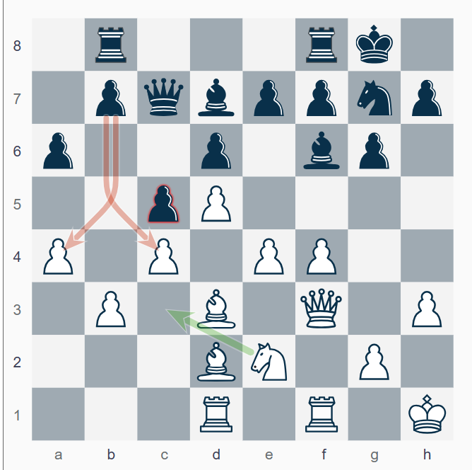
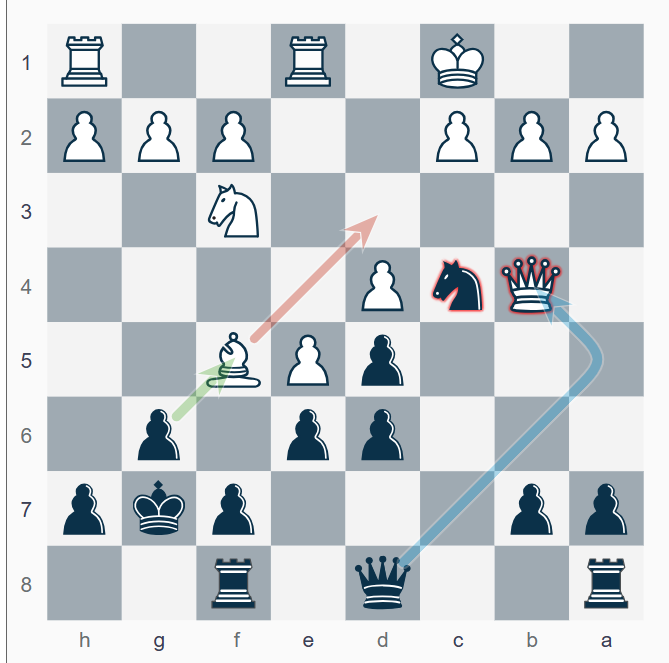

<small>Photo by <a href="https://unsplash.com/@jccards?utm_content=creditCopyText&utm_medium=referral&utm_source=unsplash">Marek Studzinski</a> on <a href="https://unsplash.com/photos/a-person-holding-a-knife-in-their-hand-TE9qfpoOCzo?utm_content=creditCopyText&utm_medium=referral&utm_source=unsplash">Unsplash</a></small>
  
# Introduction

Before sharing the latest updates on my progress in the Electronic Knights tournament, I want say thank you all for reading, comments and a special thank you to my supporters for the coffee.

I finished my last two games in the Electronic Knights Finals. 
And WOW, what a journey over the last 3 years!

There's always something new to discover in chess. During the pandemic I signed up a US Chess Federation (USCF) membership and as a chess enthusiast with a long hiatus, this decision marked a significant turning point. After some test tournaments [such as the Victor Palciauskas tournament](https://chess.myvortexcloud.com/victor-palciauskas-tournament) I signed up for the Electronic Knights, which was played then via email.

Since 2024, the entire Electronic Knights tournament series moved to the ICCF platform but retained USCF Correspondence Chess Rules (engine-free). Players can register for up to ten sections. I initially competed in the preliminary rounds of two sections, 21EN09 and 21EN015. To my surprise, I advanced to the semifinals and then to the finals!

All games can be found in the [tournament section of this webpage.](https://chess.myvortexcloud.com/tournaments/)

# Electronic Knights 2021 - Finals

## Section 21ENf01

First, let me highlight how long correspondence chess takes. This tournament started in 2021, and here we are—three years later—in the finals. That really sets things in perspective! USCF's decision to move to the ICCF server with its engine-free format was a great one. It made playing much easier compared to email.

The finals started on **January 19, 2024**, and will end on **July 19, 2026**. As of **May 2024**, I broke into the **Top 100 Correspondence Chess Players in the USA** at [Rank #73](https://www.uschess.org/component/option,com_top_players/Itemid,371?op=list&month=2405&f=usa&l=C:Top%20Correspondence%20Ratings.&h=Correspondence%20Players) with an ELO of 2099. Today, I’m proud to be ranked [#67](https://www.uschess.org/component/option,com_top_players/Itemid,371?op=list&month=2411&f=usa&l=C:Top%20Correspondence%20Ratings.&h=Correspondence%20Players) with ELO of 2104!

For those curious about rating calculations, USCF provides an excellent guide on [how ratings are calculated](https://new.uschess.org/correspondence-chess/ratings).

In the finals, the **Weighted Score System** brings everything together. Here’s how it works:

### Original Weighted Points Formula

The weighted score combines the scores from the **Preliminaries**, **Semifinals**, and **Finals**, with later rounds often having higher weightage. Assuming the weightage is proportional (e.g., Finals are weighted higher than Semifinals, and Semifinals higher than Preliminaries), we calculate:

**Weighted Points** =  
*(Prelim Score)* × **W₁** + *(Semi Score)* × **W₂** + *(Final Score)* × **W₃**

Where **W₁**, **W₂**, and **W₃** are weight factors.

#### Scoring System Breakdown:
- **Prelim Score**: Each win counts as **1.0 point**. Draws count as **0.5 points**.
- **Semi-final Score**: Each win counts as **2.2 points**. Draws count as **1.1 points**.
- **Final Score**: Each win counts as **4.5 points**. Draws count as **2.25 points**.

- **W₁ = 1.0** (Preliminaries)
- **W₂ = 2.2** (Semifinals)
- **W₃ = 4.5** (Finals)

This system emphasizes the importance of all rounds. While two games are still ongoing, here’s the likely final ranking:

**_not official ranking under assumption Reger and Corkum win their game_**

| **Rank** | **Player Name**          | **Prelim Score** | **Semi-Final Score** | **Finals Score** | **Weighted Score** |
|----------|--------------------------|------------------|----------------------|------------------|--------------------|
| 1        | **REGER, JEFFREY**        | 5                | 5.5                  | 4                | 35.1               |
| 2        | **BARCLAY, DEAN ARNE**    | 5.5              | 5.5                  | 3.5              | 33.35              |
| 3        | **CORKUM, TIM**           | 5                | 4.5                  | 4                | 32.9               |
| 4        | **BUSS, MICHAEL D**       | 5                | 5.5                  | 3                | 30.6               |
| 5        | **SCHROEER, EGBERT**      | 5.5              | 5                    | 3                | 30.0               |
| 6        | **WEINER, GERALD**        | 5.5              | 4                    | 2                | 23.3               |
| 7        | **NOHR, MATTHEW**         | 4.5              | 4                    | 1.5              | 20.05              |

Cash prizes will be distributed as follows based on weighted-point scores as in Rule #12:
- First Place: $800.00, plus title of Golden/Electronic Knights Champion and a plaque
- Second Place: $500.00
- Third Place: $300.00
- Fourth-Tenth: $100.00 each.

**Note:** Prize fund based on 200 entries and will be increased or decreased proportionately per number of entries assigned. A minimum of 50% of each prize will be paid. Players who complete all games and do not qualify for the Semi-final round will receive a CC gift certificate valued at $10.00. Those who complete all three rounds with no forfeit losses will receive a tournament pin and be eligible to win prize money depending on their weighted-point score.

You can find a summary about [my opponenents in the tournament section.](https://chess.myvortexcloud.com/tournaments/my-opponents/)

Having finished my last two games (both drawn), I’m very likely to end 5th place—depending on the outcome of the final games. Stay tuned!

Enjoy!

# 1. Game Analysis: Buss, Michael  

This might be my fourth game against Michael in correspondence chess, and as always, it featured high-level play. Let’s dissect the key moments and explore what likely cost White the win.  

#### Annotated Game  

Have a look at the annotated game below for a detailed move-by-move breakdown, including my thoughts and variations during the game. 
I then captured, highlighted and reflected on the critical moments.
 
<iframe style='border: 0;' width='900px' height='600px' src='https://share.chessbase.com/SharedGames/frame/?p=XKWkcm88uIVa61Rbf3uXVBDxmTe/ktOY6DlFK2bloa3D6V1lcFOFt2qToLCHIa8t'></iframe>

 

## Critical Moments  
#### **Move 21: g4**  
The move **21. g4** is aggressive, aiming to seize space and open attacking prospects on the kingside. However, it could have been better timed. A quieter move like **21. Nc3** would have maintained flexibility, addressed Black’s queenside counterplay, and kept White’s position solid. The pawn push weakens White's structure, providing Black with targets for later exploitation.  

    

 

#### **Move 27: Bxc4**  
Black's pawn sacrifice with **27. Bxc4** was a calculated attempt to activate pieces and generate counterplay. White’s acceptance of the pawn with **27. Bxc4** was correct and maintained the advantage. Declining the pawn with **27. bxc4** would have allowed Black’s rook to infiltrate with **Rb3**, creating significant activity. While White was correct to accept the sacrifice, this position demanded precise follow-up to consolidate and retain control.  

#### **Move 31: Rxe5**  
White voluntarily exchanges into a less dynamic structure with **31. Rxe5**. The alternative **31. Rf1** would have kept the tension and preserved opportunities for dynamic play, including doubling rooks or pressing against Black’s kingside. By exchanging rooks, White reduces the complexity of the position and shifts towards an endgame that favors Black’s defensive chances.  

### Endgame Play  

#### **Move 36: Qxf6+**  
Simplifying into a rook-and-pawn endgame with **36. Qxf6+** was a turning point. While White retains a material edge, the queen exchange eliminates attacking chances and gives Black counterplay against White’s pawns. Keeping queens on the board would have preserved White’s initiative and kept Black on the defensive.  

#### **Move 45: b6**  
The move **45. b6** prematurely advances White’s passed pawn, forcing Black to stabilize the position. While logical, this move commits White to a specific plan and limits flexibility. A more patient approach, such as **45. Kf2**, would have centralized the king and allowed White to maneuver while waiting for Black to commit.  

### What Cost White the Game?  

White's primary challenge in this game was converting advantages into a decisive win. Key issues include:  

- **Premature pawn pushes** (e.g., **g4**, **b6**) created weaknesses that Black exploited for counterplay.  
- **Simplifications** (e.g., **Rxe5**, **Qxf6**) reduced White’s attacking chances and allowed Black to escape into drawable positions.  
- **Missed improvements** in critical moments, such as **21. Nc3** and maintaining tension with **31. Rf1**, which could have kept White’s winning edge intact.  

The game demonstrates the importance of balancing aggression with caution, particularly in correspondence chess, where deep analysis can uncover nuances missed during the game.  

---

# 2. Game Analysis: Weiner, Jeff  

Playing against Gerald (Jeff) Weiner is always an engaging experience. In this game, as Black, I managed to hold a draw in a challenging position. However, the game slipped out of my hands due to a combination of passive decisions, missed opportunities for counterplay, and suboptimal endgame coordination.  

Stronger emphasis on dynamic play, particularly in the opening and middle game, and earlier activation of the king in the endgame, would have significantly enhanced my winning chances.  

#### Annotated Game 

My thoughts during the game are reflected in the annotations.  

<iframe style='border: 0;' width='900px' height='600px' src='https://share.chessbase.com/SharedGames/frame/?p=KswIjm3DcIRkdjEWeeq5y4YEb0bFm+5OrWJCDv5b9w21cRldqNECtNdVswQwFmWY'></iframe>

 

### Critical Moments and Analysis  

#### 1. Move 11...Nb6  
- **not the best**: Black played passively with **11...Nb6**, allowing White to develop with tempo.  
- **Better Alternative**: **11...dxe5**, followed by active piece play, would have kept Black in the game with a solid center.  

#### 2. Move 15...a5  
- **Mistake**: Black prioritized a flank pawn push instead of consolidating the center.  
- **Better Alternative**: **15...exf5**, immediately breaking White's pawn structure and activating Black’s kingside pawns.  

    

 

#### 3. Move 21...Qc7  
- **Mistake**: A missed opportunity to maintain pressure by playing **21...Ra6**, which would have supported the c6 pawn and countered White's initiative on the queenside.  
- **Better Alternative**: **21...Ra6**, ensuring better balance and enabling active rook play.  

#### 4. Move 30...Qxb5  
- **Mistake**: Prematurely transitioning to the endgame by simplifying too much.  
- **Better Alternative**: **30...Qxd4**, retaining queens for counterplay and increasing Black’s chances of maintaining dynamic pressure.  

### Black’s Key Mistakes  

1. Passive moves like **11...Nb6** and **15...a5** ceded the initiative to White.  
2. Failure to play dynamically, particularly in positions requiring precise counterplay (e.g., **21...Qc7** and **57...Rg4**).  
3. Premature simplifications such as **30...Qxb5**, leading to a suboptimal endgame.  

These little things, when combined, cost Black the chance to convert a promising position into a victory. However, a flawless play and holding a draw was a good result. 

---

## Stay Connected  

Thank you for reading! I’ll continue sharing insights and results from tournaments and chess adventures here.

I wish you all a Happy Thanksgiving

**Amici Sumus** – We are friends!  

If you find value in my content, consider supporting me with a virtual coffee ☕️ or a beer 🍺. Your contributions help keep this blog thriving.  

Stay updated by [subscribing to my blog](https://follow.it/senior-chess-improver?leanpub) and sharing it with your chess friends.

